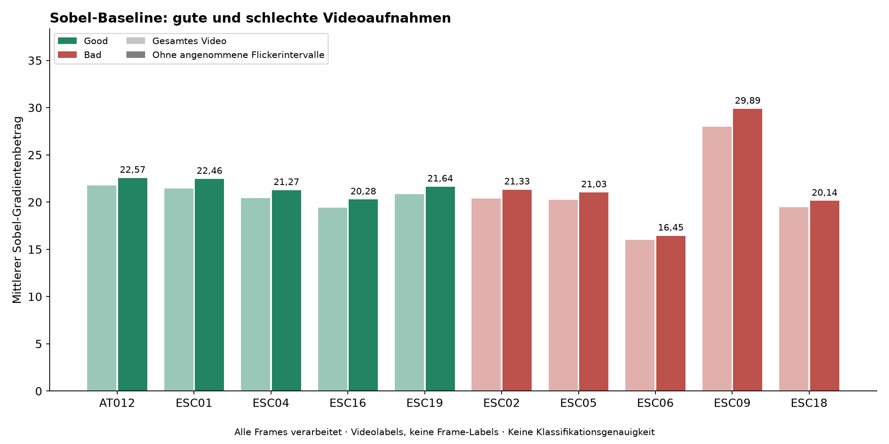
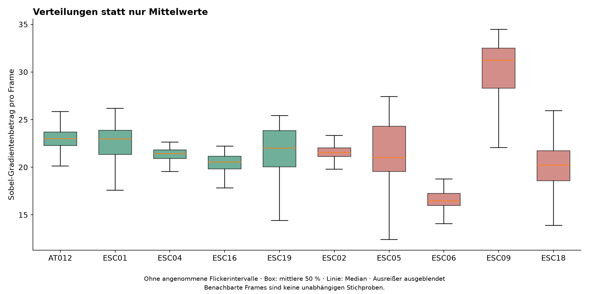
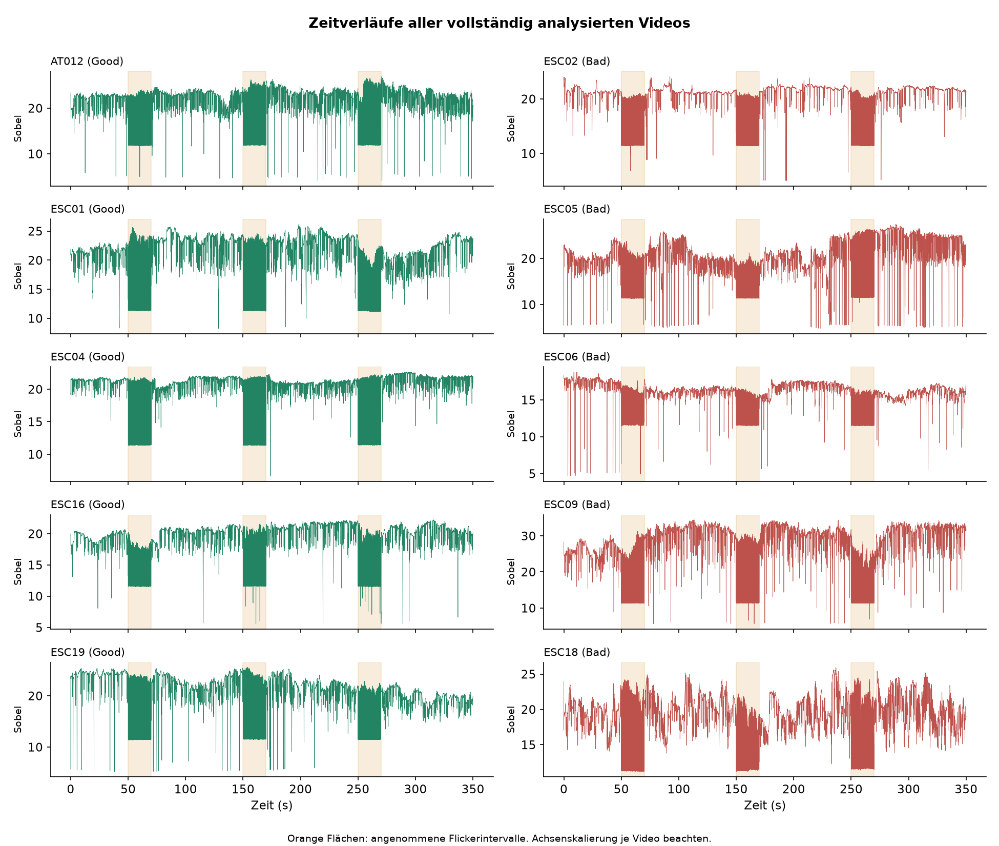
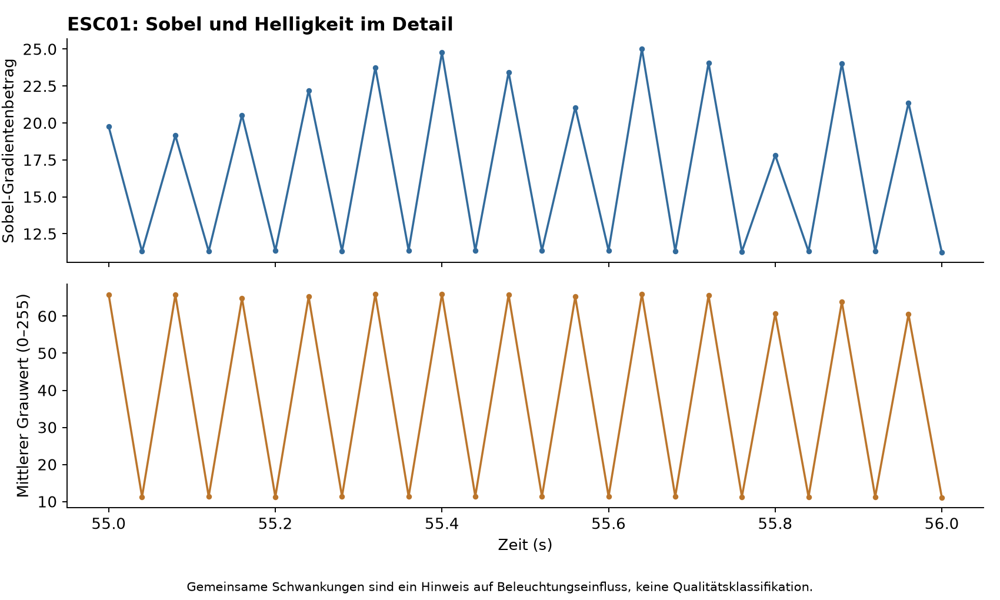

# Sobel-Baseline: vollständige Auswertung von zehn Videos

## Fragestellung und Umfang

Unterscheiden sich die Sobel-Werte der als Good bzw. Bad bereitgestellten
Augenhintergrundvideos? Die erste Untersuchung mit ESC01/ESC02 wurde auf alle
fünf Good- und fünf Bad-Aufnahmen aus dem Kursmaterial erweitert.

**Alle 87.522 Frames wurden verarbeitet.** Es handelt sich hier nicht mehr um
die vorangegangene Stichprobe von 26 ausgewählten Frames pro Video.
AT012 und ESC04 enthalten jeweils 8.753 Frames, die übrigen Videos 8.752.
Alle zehn Aufnahmen haben 720 × 576 Pixel, 25 FPS und etwa 350 Sekunden Länge.

## Methode

Die Baseline aus `src/analyze_video.py` bleibt erhalten:

1. Video dekodieren, BGR in Graustufen umwandeln.
2. Sobel in X- und Y-Richtung, 3×3-Kernel, 64-Bit-Fließkommazahlen.
3. Gradientenbetrag `sqrt(Gx² + Gy²)` pro Pixel berechnen.
4. Mittleren Gradientenbetrag und mittlere Helligkeit pro Frame speichern.
5. Verteilungen, Zeitverläufe und Videozusammenfassungen vergleichen.

Algorithmuskennung: `gray-bgr-opencv-sobel3-float64-mean-v1`.
Software: OpenCV 5.0.0, PyAV 19.0.2, NumPy 2.3.5.
Die Zeitachse verwendet relative dekodierte PTS, keine geschätzte Anzahl
von Frames aus dem missverständlichen DV-Feld `average_rate`.

Es wurde das ganze Bild ohne FOV-Maske, Deinterlacing, Größenänderung oder
Intensitätsnormalisierung ausgewertet. Die Aufnahmen sind interlaced; ein
anderes Preprocessing wäre als eigener Versuch zu dokumentieren.

## Ergebnisse

Die angenommenen Flickerintervalle [50,70], [150,170] und [250,270] Sekunden
werden für eine zweite Statistik einschließlich ihrer Grenzen ausgeschlossen.
Das Protokoll ist für diese konkreten Aufnahmen noch fachlich zu bestätigen.
Keine Frames werden aus den gespeicherten Zeitserien gelöscht.

| Video | Videolabel | Frames | Sobel gesamt | Sobel ohne angen. Flicker | Median ohne angen. Flicker | Helligkeit ohne angen. Flicker |
|---|---|---:|---:|---:|---:|---:|
| AT012 | Good | 8753 | 21,75 | 22,57 | 23,00 | 76,33 |
| ESC01 | Good | 8752 | 21,45 | 22,46 | 22,97 | 63,69 |
| ESC04 | Good | 8753 | 20,45 | 21,27 | 21,43 | 60,82 |
| ESC16 | Good | 8752 | 19,42 | 20,28 | 20,56 | 58,39 |
| ESC19 | Good | 8752 | 20,87 | 21,64 | 22,00 | 64,53 |
| ESC02 | Bad | 8752 | 20,40 | 21,33 | 21,56 | 71,62 |
| ESC05 | Bad | 8752 | 20,23 | 21,03 | 20,99 | 72,16 |
| ESC06 | Bad | 8752 | 15,99 | 16,45 | 16,48 | 58,54 |
| ESC09 | Bad | 8752 | 27,98 | 29,89 | 31,22 | 74,01 |
| ESC18 | Bad | 8752 | 19,47 | 20,14 | 20,23 | 57,72 |

### Zentrale Beobachtung

Die Good-Videos liegen ohne angenommene Flickerintervalle im Bereich
**20,28 bis 22,57**, die Bad-Videos im Bereich
**16,45 bis 29,89** (jeweils Video-Mittelwerte).
ESC09 ist als Bad markiert und erreicht dennoch
**29,89**.
Damit bestätigt die vollständige Auswertung das zuvor nur stichprobenartig
beobachtete Gegenbeispiel. Ein einzelner monotoner Grenzwert nach dem Prinzip
„hoher mittlerer Sobel-Wert = Good“ trennt die vorliegenden Videolabels nicht.

Das ist eine Beobachtung auf diesen zehn Aufnahmen, keine gemessene
Klassifikationsgenauigkeit auf unabhängigen Testdaten. Der Grund der
Bad-Einstufung und die Relevanz einzelner Gefäßregionen bleiben zu klären.

Die Boxplots zeigen die mittleren 50 % und den Median der Frame-Werte;
Ausreißerpunkte werden für die Lesbarkeit ausgeblendet. Benachbarte Frames
sind zeitlich abhängig. Die große Framezahl darf nicht als Anzahl unabhängiger
Patienten oder Versuche interpretiert werden.

### Anschluss an den ersten Versuch

ESC01: 22,46,
ESC02: 21,33 ohne die angenommenen
Flickerintervalle. Diese Sobel-Werte stimmen mit dem bisherigen Bericht bei
Rundung auf zwei Nachkommastellen überein.

Die neue Berechnung stimmt bei ESC01 und ESC02 über sämtliche gespeicherten
Sobel-/Helligkeitswerte und Zeitstempel mit der vorherigen unabhängigen
Vollauswertung überein (numerischer Abgleich mit Toleranz 1e-12).

### Flicker und Helligkeit

Der Ausschnitt zeigt die gleichzeitige Schwankung von mittlerem Sobel-Wert
und Helligkeit in ESC01. Er unterstützt die Beobachtung, dass der Score nicht
ausschließlich Bildschärfe misst. Die genaue Stimulationssteuerung wurde
nicht aus Metadaten ausgelesen. Flicker kann Teil des Experiments sein und
darf deshalb nicht automatisch als schlechte Aufnahme behandelt werden.

## Was ist jetzt fertig?

- Sobel und Helligkeit sind auf allen zehn Videos vollständig berechnet.
- Pro Video liegen prüfbare Frame-CSVs sowie Gesamt- und Teilstatistiken vor.
- Vier deutsch beschriftete Grafiken und eine wiederholbare Kommandozeile sind vorhanden.
- Die ursprünglichen zwei Skripte bleiben als erster Versuch unverändert.
- Zwölf automatisierte Tests bestanden: unter anderem ZIP/Datei-Parität,
  Baseline-Parität, Cache, Zeitfenstergrenzen und eine komplette CLI-/Grafikprobe.
- Der Cache wurde zusätzlich mit den realen zehn Videos wiederverwendet;
  Grafiken benötigen keine erneute Videodekodierung.

## Was wurde noch nicht nachgewiesen?

Es gibt keine validierte automatische Good/Bad-Klassifikation, keine gesicherten
Frame-Labels und keine bestätigte Patientenunabhängigkeit. Die 5:5-Videolabels
sind nicht gleichbedeutend mit 5:5 Frame-Klassen. Eine Krankheitseinstufung wird
nicht vorgenommen. Hohe Zahlen aus anderen Publikationen sind nicht auf diesen
einfachen Sobel-Mittelwert übertragbar.

## Sinnvoller nächster fachlicher Schritt

Mit dem Betreuer klären, was das Good/Bad-Label genau beschreibt, ob die
Bewertung global oder für ausgewählte Gefäßabschnitte gelten soll und wie mit
Flickerframes umzugehen ist. Danach kann derselbe Sobel-Ansatz mit einer
festgelegten FOV-/ROI-Maske geprüft werden. Kontrast und Beleuchtung können
als getrennte Merkmale hinzukommen. Wavelet oder ein CNN sind für den
abgeschlossenen ersten Sobel-Versuch keine Voraussetzung.

## Reproduktion und Dateien

Die Befehle zur Installation und Auswertung stehen in [README](../README.md).

Die veröffentlichten Dateien unter `results/batch_summary/` sind aggregierte
Ergebnisse und Grafiken. Die ursprünglichen Videos, Fundusbilder und lokalen
Frame-CSVs unter `results/batch/cache/` werden nicht mitveröffentlicht.

Das Kursmaterial ist die Eingabe; bei anderen Decoder-/Bibliotheksversionen
können insbesondere die Helligkeitswerte leicht abweichen. Ein normaler Lauf
validiert den Cache gegen Eingabedatei und Softwareversionen. `--plots-only`
prüft die gespeicherten CSV-Prüfsummen, benötigt aber die Quelle nicht erneut.
